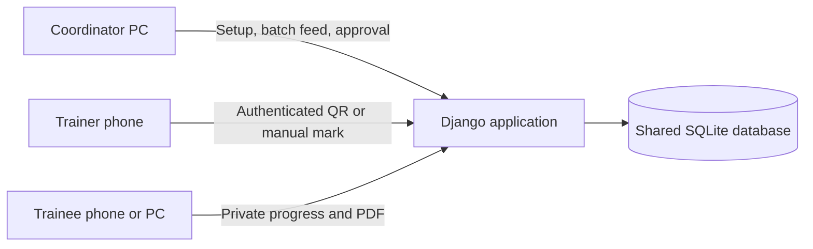

# Trainee Attendance & Certificate Review

A coordinator can see which training sessions a trainee attended before approving a certificate. Trainers take attendance on a phone. Trainees sign in to see their own progress and download an approved PDF. This independent prototype was inspired by industrial vocational training. All demo people, sessions and passes are fictional.

## Architecture

The phone and desktop use the same server URL. Each trainer mark commits to a single register. Visible coordinator review and trainee progress pages poll authorized JSON feeds every five seconds. Hidden tabs pause polling, and failed requests back off to at most one minute. QR decoding runs locally on the phone with bundled jsQR. A badge identifies a trainee and an authenticated trainer confirms presence.

## Start locally

Requires Python 3.11+ and a modern browser.

    python -m venv .venv
    source .venv/bin/activate
    pip install -r requirements.txt
    python manage.py migrate
    python manage.py demo
    python manage.py runserver

Open **http://127.0.0.1:8000/**. On Windows use `.venv\Scripts\activate`. The demo command prints a generated password alongside each new username. Save these locally. Running it again preserves existing records and passwords. Reset a forgotten password with `python manage.py changepassword USERNAME`.

## Demo accounts

| Username | View | Initial evidence |
|---|---|---|
| demo-coordinator | Setup, printable passes, live review and approval | Both batches |
| demo-trainer | Mobile register | Assigned sessions |
| demo-regular | Private trainee page | 4/4, eligible for review |
| demo-partial | Private trainee page | 2/4, below threshold |
| demo-final-day | Private trainee page | 1/4, attended only the last session |
| demo-live | Private trainee page | P-101 in the separate open practice session |

## Walk through the system

1. Sign in as coordinator. Open the completed batch. Approve the eligible trainee and download the certificate. Sign in as demo-regular in a separate browser profile to download the same PDF. A partial-attendance trainee can see their progress.
2. Open the live practice batch on the coordinator PC. Select **Print ID pass** for P-101. Print or display the QR and printed fallback ID.
3. In a separate browser session, sign in as demo-trainer and select **Practice workshop**. Scan the badge or type **P-101**. Try it twice. The unique session/trainee pair counts once. Check the open PC review and demo-live progress screens.
4. Close the register after checking the roster. Until closure, unmarked entries are pending. After closure, unmarked entries count as absent. A trainer can correct a mark with a recorded reason before approval.
5. The coordinator reviews eligibility and explicitly approves. The PDF records the attendance fraction at approval. The demo threshold is 75%; coordinators set the actual threshold per batch.

## Setting up your own batch

In **Manage batches, trainees and sessions**, create a batch, add trainees and assign each session a date and trainer. Give operational coordinators the **Can coordinate the training register** permission through a Django group. Their accounts can remain ordinary users. Grant separate staff access and specific training-model permissions to people who maintain batches, trainees and sessions through setup. Reserve superusers for system administration and emergency access.

| Role | Register access |
|---|---|
| Coordinator | All batches, passes, registers, reviews, approvals, audit records and certificates |
| Assigned trainer | Registers for assigned sessions and corrections the register permits |
| Linked trainee | Their own progress feed and approved certificate |
| Setup staff | The setup models for which they have explicit Django permissions |
| Superuser | System administration and coordinator access |

Both sign-in forms share a 15-minute attempt window. The limits are five attempts per username and client address and 30 attempts per client address across usernames. Excess attempts receive HTTP 429 and a retry time. The application hashes the rate-limit keys and uses the web server's `REMOTE_ADDR`. Configure client addresses at the trusted server boundary if it otherwise supplies the proxy's shared address. Forwarded address headers from the request do not affect the limits.

## Connect a phone

On trusted Wi-Fi, set `ALLOWED_HOSTS=localhost,127.0.0.1,YOUR_PC_LAN_IP` and run `python manage.py runserver 0.0.0.0:8000`. Open the PC's LAN address on both devices. Manual entry works over LAN HTTP. For phone camera scanning, serve the app through HTTPS and allow camera access. Localhost is also a secure context for testing on one machine.

## API and storage

| Endpoint | Access and function |
|---|---|
| POST /api/sessions/{id}/attendance/ | Assigned trainer, form data with code and CSRF token, JSON response with Accept: application/json |
| GET /api/batches/{id}/ | Coordinator batch progress and session counts |
| GET /api/me/ | Signed-in trainee's own marks and eligibility |
| POST /approve/{trainee_id}/ | Coordinator approval, server checks threshold and pending registers |
| GET /certificate/{trainee_id}.pdf | Approved trainee or coordinator |

SQLite transactions serialize register writes and approval decisions. A database uniqueness constraint prevents duplicate marks. Approval stores the reviewer, timestamp, threshold and attendance counts. A batch should contain a fixed cohort and planned sessions before final review.

For hosting use a persistent volume for `DATABASE_PATH`, set `APP_ENV=production`, `SECRET_KEY` and specific comma-separated `ALLOWED_HOSTS`, run migrations and `collectstatic`, and serve static files and Gunicorn behind HTTPS. Production redirects HTTP and uses secure cookies. Configure `CSRF_TRUSTED_ORIGINS` for explicitly trusted cross-origin submissions. Enable `SECURITY_TRUST_PROXY_HTTPS=1` only behind a trusted proxy that overwrites incoming `X-Forwarded-Proto` and blocks direct client access to the application server. HSTS starts at 300 seconds. Increase `SECURITY_HSTS_SECONDS` after confirming HTTPS stability and set `SECURITY_HSTS_INCLUDE_SUBDOMAINS=1` only after verifying every subdomain supports HTTPS. Django deployment warnings W005 and W021 reflect the staged subdomain and preload policy.

## Verification

    python manage.py test

Tests cover role boundaries, repeat scans, correction history, pending registers, attendance thresholds, private trainee feeds and certificate downloads. Camera decoding uses jsQR 1.4.0; its license is included under training/static/vendor.

GitHub Actions runs the Django suite on Python 3.12 and 3.13, validates the migration graph, checks JavaScript, and runs a separate Chromium workflow. To run the browser workflow locally:

    python -m pip install -r requirements-browser.txt
    python -m playwright install chromium
    python manage.py test training.browser_checks

The browser workflow starts a loopback server with a fresh fixture database. It exercises mobile manual attendance, simulated camera denial and network failures, correction and closure, coordinator approval, private certificate downloads and the recovery banner. Set `REGISTER_BROWSER_CHANNEL=msedge` to use an installed Microsoft Edge browser.

## Manual attendance and audit review

For a typed trainee ID, select **QR Camera Issue**, **Medical Leave**, **Official Plant Duty**, **Network Error**, or **Roster Correction**. Add a note of up to 240 characters if needed. Camera scanning submits the badge UUID through the scan path; the printed trainee ID is accepted only through manual entry. Badge possession is not proof that a physical camera was used.

The assigned trainer or a coordinator can correct a register with a reason. Once every register is closed, a coordinator may expand **Below threshold · Review override**, document the exception and approve a certificate. The original attendance fraction stays on the certificate. Existing approvals lock subsequent corrections for that trainee.

Open **Audit Log** on the coordinator dashboard for timestamp (IST), trainee, session/action, staff username and role, reason and note. **Download Audit Log (CSV)** exports the full history in the same order, including records beyond the current page. Spreadsheet formula prefixes are escaped. Two fictional manual entries are included by the demo command; reruns preserve them. Existing correction history is imported by the migration.

Attendance changes, overrides and their audit inserts commit together. Historical entries store names, roles and session descriptions as snapshots. SQLite triggers block updates, deletes and replacement inserts, including ordinary direct SQL writes. A host administrator who can replace the database or drop triggers can still alter history. For independently verifiable retention, export to separately controlled immutable storage under the organization's retention policy.

After pulling this version run `python manage.py migrate` and, for demo installations, `python manage.py demo`.

### Detect a database rollback

Opening **Audit Log** saves a signed SHA-256 receipt on that coordinator's browser. On later visits, the app compares the entire previously witnessed prefix, including row IDs, UTC timestamps and snapshot fields. Additional rows are allowed. Missing or changed witnessed rows produce a warning and the browser retains its earlier receipt. Receipts contain a count and digest, without trainee names or notes.

Download the receipt after each review and retain the latest copy on an HR-controlled device. Upload it on the Audit Log page to verify history from another browser. Keep the production signing key stable and backed up separately. First use establishes a baseline. Changes made and lost between reviews are outside its coverage. Clearing browser storage removes its local baseline. A receipt detects differences and cannot recover missing data; maintain separately controlled backups for recovery. This check assumes trusted application code.

### Restore Monday's backup and keep Tuesday's audit entries

Stop application writers before the final recovery. Keep both the current SQLite database and a consistent SQLite backup from the same installation. Both must contain the audit table. From the project directory:

    python manage.py restore_with_audit backups/monday.sqlite3 recovered.sqlite3

The command copies Monday's database to a new file, verifies that its audit history matches the beginning of the current database's history, and appends every later audit row with its original ID, timestamp and staff attribution. The original files stay intact. A conflicting history or an existing output path stops the operation. To supply Tuesday's snapshot separately, add `--current backups/tuesday.sqlite3`.

Start the app with `DATABASE_PATH` set to the absolute path of the recovered file, using the original signing key. Run pending migrations on that file if needed. Audit Log, CSV export and previously saved receipts all use the combined history. Other tables, including attendance marks and certificate approvals, reflect the chosen backup. If you also need Tuesday's operational state, use the intact Tuesday database. A receipt alone cannot reconstruct missing rows.

After a restore, the coordinator's **Review this restore** page shows the pending incident. An authorized host operator must select an intact, independently held SQLite snapshot with the exact audit history retained before the restore marker. Establish the snapshot's provenance through separate custody and keep both source databases intact. Run the following with `DATABASE_PATH` set to the quarantined candidate and the application offline:

    python manage.py reconcile_recovery authoritative.sqlite3 --actor coordinator --note "Verified independently retained register snapshot"

The command compares the training schema, audit history, batches, roster, sessions, attendance, approvals and certificate snapshots, corrections, and identity and permission records. It excludes authentication session state and last-login timestamps. Successful verification appends the marker and evidence digests under the named active coordinator. Historical web reviews remain in the audit trail and require independent evidence to clear quarantine. If evidence differs or is unavailable, keep the candidate quarantined and prepare a fresh candidate from an intact authoritative source. Retain every source and any independently held audit receipts for review.

## Operations

### Health and monitoring

- Request `/health/live/` without cookies to check that the application responds.
- Request `/health/ready/` without cookies to check database access and recovery status. A 503 can mean the candidate is intentionally quarantined. Use liveness for restart decisions and investigate readiness separately.
- Track HTTP 5xx rates, SQLite lock errors, request latency, available disk space, backup age, and the last successful restore drill. Keep names, credentials, badge values, and audit notes out of monitoring exports. Review web-server access logs before forwarding them.

### Backups and rollback

Set `DATABASE_PATH` to the intended SQLite source and back up to a new path on a filesystem that supports hard links.

    python manage.py backup_register backups/register-2026-11-24.sqlite3

The command uses SQLite's online backup API, includes committed WAL data, checks integrity and foreign keys, and publishes a new file without overwriting an existing one. Copy verified backups to encrypted, access-controlled storage independent of the application host. Keep the signing key separately protected. Agree on recovery point and recovery time objectives, schedule backup frequency and retention against them, and test restores regularly on isolated copies.

Take a pre-migration backup at each release. Record the application commit, schema migration, backup identifier, and receipt. Run system and migration checks on a staged copy, then run the recovery drill and verify readiness before enabling writers. If a rollback is needed after a schema change, preserve the current database and newer audit receipts. Use the matching application version and an isolated restored candidate first. Treat any post-backup operational changes as evidence to reconcile before authorizing traffic.

### SQLite capacity

SQLite serializes register writes, and the integrity and quarantine triggers use SQLite SQL. Use a persistent local volume with one application host. Measure concurrent write latency and lock failures against the expected register traffic. Before moving to PostgreSQL, reproduce every constraint and trigger, audit and certificate immutability, recovery semantics and the concurrency suite on an isolated PostgreSQL database.

Run the synthetic endpoint benchmark with `python manage.py test training.performance_benchmark`. The local fixture has 120 trainees, 24 sessions, 2,160 marks and 30 approvals. Ten requests per endpoint produced these medians:

| Endpoint | SQL before → after | Median before → after |
|---|---:|---:|
| Home | 30 → 6 | 12.07 → 5.05 ms |
| Coordinator review | 395 → 7 | 187.78 → 23.90 ms |
| Coordinator feed | 7 → 7 | 24.59 → 8.41 ms |
| Trainee feed | 8 → 6 | 4.89 → 3.11 ms |

These timings use Django's local test client and synthetic SQLite data. Measure network and concurrent production-like latency separately.
