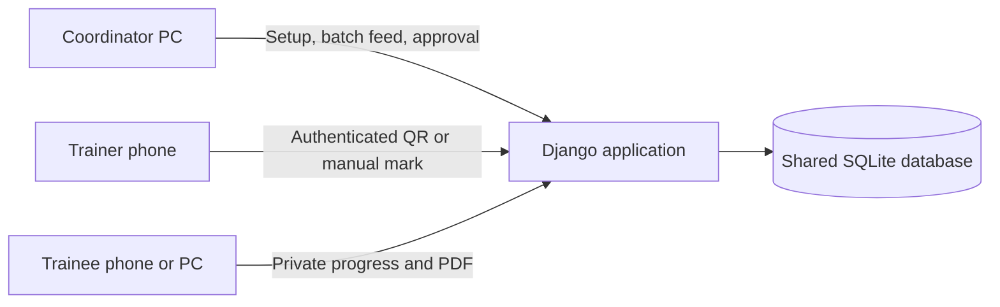

# Trainee Attendance & Certificate Review

A coordinator can see which training sessions a trainee attended before approving a certificate. Trainers take attendance on a phone. Trainees sign in to see their own progress and download an approved PDF. This independent prototype was inspired by industrial vocational training. All demo people, sessions and passes are fictional.

## Architecture

The phone and desktop use the same server URL. Each trainer mark commits to a single register. Open coordinator review and trainee progress pages poll their authorized JSON feeds every two seconds. QR decoding runs locally on the phone with bundled jsQR. A badge identifies a trainee and an authenticated trainer confirms presence.

## Start locally

Requires Python 3.11+ and a modern browser.

    python -m venv .venv
    source .venv/bin/activate
    pip install -r requirements.txt
    python manage.py migrate
    python manage.py demo
    python manage.py runserver

Open **http://127.0.0.1:8000/**. On Windows use `.venv\Scripts\activate`. The demo command prints a generated password alongside each new username. Save these locally. Running it again preserves existing records and passwords. Reset a forgotten password with `python manage.py changepassword USERNAME`.

## Demo accounts

| Username | View | Initial evidence |
|---|---|---|
| demo-coordinator | Setup, printable passes, live review and approval | Both batches |
| demo-trainer | Mobile register | Assigned sessions |
| demo-regular | Private trainee page | 4/4, eligible for review |
| demo-partial | Private trainee page | 2/4, below threshold |
| demo-final-day | Private trainee page | 1/4, attended only the last session |
| demo-live | Private trainee page | P-101 in the separate open practice session |

## Walk through the system

1. Sign in as coordinator. Open the completed batch. Approve the eligible trainee and download the certificate. Sign in as demo-regular in a separate browser profile to download the same PDF. A partial-attendance trainee can see their progress.
2. Open the live practice batch on the coordinator PC. Select **Print ID pass** for P-101. Print or display the QR and printed fallback ID.
3. In a separate browser session, sign in as demo-trainer and select **Practice workshop**. Scan the badge or type **P-101**. Try it twice. The unique session/trainee pair counts once. Check the open PC review and demo-live progress screens.
4. Close the register after checking the roster. Until closure, unmarked entries are pending. After closure, unmarked entries count as absent. A trainer can correct a mark with a recorded reason before approval.
5. The coordinator reviews eligibility and explicitly approves. The PDF records the attendance fraction at approval. The demo threshold is 75%; coordinators set the actual threshold per batch.

## Setting up your own batch

In **Manage batches, trainees and sessions**, create a batch, add trainees and assign each session a date and trainer. For a trainer, create an ordinary Django user and assign them to sessions. For a trainee, create a separate ordinary user and select it in their trainee record. Coordinator accounts are trusted system administrators. Only assigned trainers can record attendance, and a trainee login can access only its own progress and PDF.

## Connect a phone

On trusted Wi-Fi, set `ALLOWED_HOSTS=localhost,127.0.0.1,YOUR_PC_LAN_IP` and run `python manage.py runserver 0.0.0.0:8000`. Open the PC's LAN address on both devices. Manual entry works over LAN HTTP. For phone camera scanning, serve the app through HTTPS and allow camera access. Localhost is also a secure context for testing on one machine.

## API and storage

| Endpoint | Access and function |
|---|---|
| POST /api/sessions/{id}/attendance/ | Assigned trainer, form data with code and CSRF token, JSON response with Accept: application/json |
| GET /api/batches/{id}/ | Coordinator batch progress and session counts |
| GET /api/me/ | Signed-in trainee's own marks and eligibility |
| POST /approve/{trainee_id}/ | Coordinator approval, server checks threshold and pending registers |
| GET /certificate/{trainee_id}.pdf | Approved trainee or coordinator |

SQLite transactions serialize register writes and approval decisions. A database uniqueness constraint prevents duplicate marks. Approval stores the reviewer, timestamp, threshold and attendance counts. A batch should contain a fixed cohort and planned sessions before final review.

For hosting use a persistent volume for `DATABASE_PATH`, set `APP_ENV=production`, `SECRET_KEY` and `ALLOWED_HOSTS`, run migrations and `collectstatic`, serve static files and Gunicorn behind HTTPS. Back up the database. The development server is for local demos.

## Verification

    python manage.py test

Tests cover role boundaries, repeat scans, correction history, pending registers, attendance thresholds, private trainee feeds and certificate downloads. Camera decoding uses jsQR 1.4.0; its license is included under training/static/vendor.
